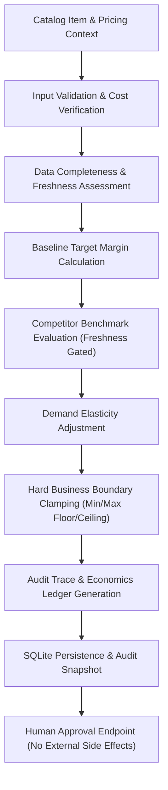

# Autonomous LFQ Pricing Agent

A configurable, explainable pricing-research and recommendation agent that evaluates structured catalog data, cost baselines, competitor signals, and business constraints to produce transparent, auditable price recommendations with human-in-the-loop approval.

Status: Pre-release / Portfolio demonstration (v0.1.0).

---

## Domain & Acronym Specification

> **Notice on LFQ**: In accordance with the build brief, the acronym **LFQ** is preserved exactly as supplied in the project identity. Its industry expansion, product taxonomy, and organizational business policy were not specified; therefore, the engine is architected to be completely domain-configurable (e.g. industrial components, wholesale distribution, SaaS, or retail). The synthetic catalog data and sample policies included herein are strictly illustrative.

---

## Safety Boundary: Decision-Support Only

This system is strictly an **explainable decision-support tool**.
- Recommendations are computed and presented with an audit trail of every applied rule.
- Human review and approval are formally recorded via the approval workflow.
- **The system never automatically publishes, submits, or applies prices to external production systems or market channels.**

---

## Key Capabilities

- **Exact Financial Calculations**: Computes gross margins, markups, and target-margin prices using Python's `Decimal` with `ROUND_HALF_UP` rounding to eliminate binary floating-point inaccuracies.
- **Inspectable Audit Trace**: Every recommendation records the exact sequence of applied rules, showing price before, price after, and the specific impact of each rule.
- **Competitor Signal & Freshness Evaluation**: Automatically filters out stale competitor observations based on configurable observation age thresholds.
- **Hard Business Constraint Clamping**: Enforces hard minimum price floors and maximum price ceilings, flagging clamping events with explicit warnings.
- **Data Completeness & Confidence Scoring**: Generates an algorithmic confidence metric based on input completeness and signal freshness (not arbitrary model hallucinations).
- **Zero-Cloud Dependency**: Runs core calculations and storage locally using SQLite and Python standard libraries without requiring paid external LLM APIs.

---

## Core Formulas & Financial Economics

All calculations use arbitrary-precision `Decimal` arithmetic:

1. **Gross Margin**:
   $$\text{Gross Margin} = \frac{\text{Price} - \text{Cost}}{\text{Price}} \quad (\text{for } \text{Price} > 0)$$

2. **Markup**:
   $$\text{Markup} = \frac{\text{Price} - \text{Cost}}{\text{Cost}} \quad (\text{for } \text{Cost} > 0)$$

3. **Target-Margin Price**:
   $$\text{Price} = \frac{\text{Cost}}{1 - \text{Target Margin}} \quad (\text{for } 0 \le \text{Target Margin} < 1)$$

4. **Clamping Constraints**:
   $$\text{Final Price} = \min(\max(\text{Computed Price}, \text{Min Price}), \text{Max Price})$$

---

## Architecture Overview



---

## Repository Structure

```text
autonomous-lfq-pricing-agent/
├── .github/
│   └── workflows/
│       └── ci.yml
├── src/
│   └── lfq_pricing/
│       ├── __init__.py
│       ├── agent.py         # Bounded agent orchestration
│       ├── api.py           # FastAPI REST application
│       ├── calculator.py    # Decimal financial formulas
│       ├── config.py        # Configuration management
│       ├── models.py        # Pydantic schemas & audit contracts
│       ├── repository.py    # SQLite local persistence layer
│       └── rules.py         # Ordered pricing rule engine
├── tests/
│   ├── conftest.py          # Synthetic catalog fixtures
│   ├── test_agent.py        # Workflow & approval tests
│   ├── test_api.py          # REST endpoint tests
│   ├── test_calculator.py   # Formula & rounding precision tests
│   └── test_rules.py        # Rule ordering & freshness tests
├── .env.example
├── .gitignore
├── pyproject.toml
├── README.md
└── SECURITY.md
```

---

## Technology Choices

- **Python 3.11+ & `Decimal`**: Exact currency rounding without binary floating-point drift.
- **SQLite (Standard Library)**: Zero-dependency local persistence for catalog items and immutable recommendation audit logs.
- **FastAPI & Pydantic v2**: High-performance typed REST API and declarative request/response validation.
- **Ruff & Pytest**: Fast linting, formatting, and unit verification.

---

## Prerequisites

- Python 3.11+ or `uv` package manager.
- No external database or paid cloud credentials required.

---

## Installation & Setup

```bash
# Clone repository
git clone https://github.com/baerozgaarmard/autonomous-lfq-pricing-agent.git
cd autonomous-lfq-pricing-agent

# Create virtual environment
uv venv --python 3.11 .venv
# On Windows:
.venv\Scripts\activate
# On Linux/macOS:
# source .venv/bin/activate

# Install in editable mode with development dependencies
uv pip install -e ".[dev]"
```

---

## Configuration

Settings are controlled through environment variables:

| Variable | Description | Required | Default |
| --- | --- | --- | --- |
| `LFQ_PRICING_HOST` | API bind address | No | `127.0.0.1` |
| `LFQ_PRICING_PORT` | API port | No | `8002` |
| `LFQ_PRICING_DB_PATH` | Path to SQLite database | No | `./data/pricing_agent.db` |
| `LFQ_PRICING_MAX_OBSERVATION_AGE_DAYS` | Max age before competitor observation is stale | No | `30` |
| `LFQ_PRICING_DEFAULT_TARGET_MARGIN` | Fallback gross margin ratio | No | `0.25` (25%) |
| `LFQ_PRICING_DEFAULT_CURRENCY` | Default ISO currency code | No | `USD` |
| `LFQ_PRICING_ALLOW_EXTERNAL_EXECUTION` | External side-effect flag (always false) | No | `false` |

---

## Running Locally

```bash
uvicorn lfq_pricing.api:app --host 127.0.0.1 --port 8002 --reload
```

Interactive OpenAPI documentation is available at `http://127.0.0.1:8002/docs`.

---

## API Usage Examples

### 1. Register a Catalog Item

```bash
curl -X POST "http://127.0.0.1:8002/v1/catalog/items" \
  -H "Content-Type: application/json" \
  -d '{
    "item_id": "LFQ-SKU-1001",
    "sku": "SKU-1001",
    "name": "Precision Industrial Actuator Assembly",
    "cost": "120.00",
    "current_price": "180.00",
    "target_margin": "0.30",
    "min_price": "150.00",
    "max_price": "250.00",
    "currency": "USD",
    "domain": "industrial_components"
  }'
```

### 2. Request a Pricing Recommendation

```bash
curl -X POST "http://127.0.0.1:8002/v1/pricing/recommendations" \
  -H "Content-Type: application/json" \
  -d '{
    "item_id": "LFQ-SKU-1001",
    "strategy": "balanced",
    "context": {
      "demand_index": 1.10,
      "competitor_observations": [
        {
          "competitor_name": "Competitor Alpha",
          "observed_price": "185.00",
          "observed_at": "2026-11-22T12:00:00Z",
          "confidence": 0.95
        }
      ]
    }
  }'
```

Response:
```json
{
  "recommendation_id": "rec_7f8e9d0a1b2c",
  "item_id": "LFQ-SKU-1001",
  "status": "recommended",
  "created_at": "2026-11-22T17:50:00Z",
  "proposed_price": "185.34",
  "recommended_min": "176.07",
  "recommended_max": "200.17",
  "currency": "USD",
  "economics": {
    "cost": "120.00",
    "proposed_price": "185.34",
    "margin": "0.3525",
    "markup": "0.5445"
  },
  "confidence": {
    "score": 0.9,
    "completeness": 0.8,
    "freshness_status": "fresh"
  },
  "applied_rules": [
    {
      "rule_id": "RULE_01_TARGET_MARGIN_BASELINE",
      "description": "Calculated baseline price using target gross margin 30.0%",
      "price_before": "120.00",
      "price_after": "171.43",
      "effect": "+51.43"
    },
    {
      "rule_id": "RULE_02_COMPETITOR_BENCHMARK",
      "description": "Adjusted for 1 fresh competitor observation(s) (median: 185.00) using 'balanced' strategy.",
      "price_before": "171.43",
      "price_after": "176.86",
      "effect": "+5.43"
    },
    {
      "rule_id": "RULE_03_DEMAND_ELASTICITY",
      "description": "Adjusted for market demand index 1.1",
      "price_before": "176.86",
      "price_after": "185.34",
      "effect": "+8.48"
    }
  ],
  "warnings": [],
  "explanation": "Recommended price USD 185.34 establishes a 35.25% gross margin (54.45% markup) based on unit cost 120.00. Applied 3 rule(s) under 'balanced' strategy.",
  "approved_at": null,
  "approver": null
}
```

### 3. Record Human Approval

```bash
curl -X POST "http://127.0.0.1:8002/v1/pricing/recommendations/rec_7f8e9d0a1b2c/approve" \
  -H "Content-Type: application/json" \
  -d '{"approver": "senior_pricing_manager", "notes": "Approved for Q1 catalog refresh."}'
```

---

## Testing & Quality Gates

Run automated verification:

```bash
# Run 14 unit and integration tests
pytest -v

# Check style and formatting
ruff check .
ruff format --check .
```

---

## Design Decisions & Trade-offs

1. **Python Decimal over Float**: In financial pricing, binary floating-point representation introduces subtle penny errors (`0.1 + 0.2 != 0.3`). Using `Decimal` guarantees exact rounding compliant with financial standards.
2. **Explicit Ordered Rules over Black-Box LLM Arithmetic**: LLMs frequently struggle with arithmetic consistency and constraint boundaries. The core pricing calculations are handled by deterministic Python domain logic, while audit trails guarantee complete traceability.
3. **Local SQLite Persistence**: SQLite requires zero administrative overhead, handles concurrency with transactions, and leaves a clean, portable audit ledger.

---

## Known Limitations

- Multi-currency conversions are not bundled in this release; all items and competitors in a single run must share the item's declared currency.
- Seasonal bulk discounting schedules are on the roadmap for future releases.

---

## License

This project is licensed under the MIT License.
